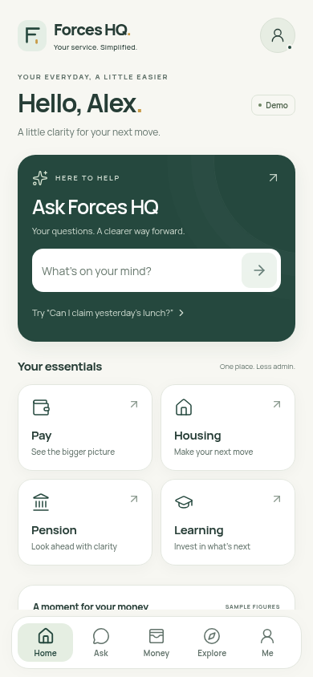
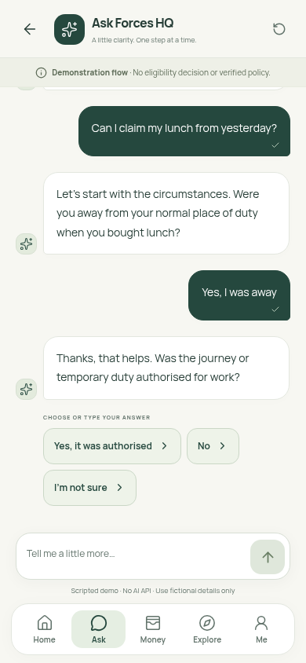

# Rendered mobile review

Real screenshots from the production-built Next.js prototype in Chromium, with touch/mobile emulation and the bundled Manrope font. No image generation, compositing or browser mockups were used. Device widths are CSS pixels. The images are captured by `tests/mobile.spec.ts` and committed for review.

## Requested widths

| Width / viewport | Home | Financial overview & opportunity | Ask conversation | Demo summary | Reduced-height Ask |
| --- | --- | --- | --- | --- | --- |
| 360 × 800 | [Home](screenshots/home-360.png) | [Overview](screenshots/home-overview-360.png) | [Ask](screenshots/ask-360.png) | [Summary](screenshots/ask-complete-360.png) | [440px height](screenshots/ask-keyboard-height-360.png) |
| 390 × 844 | [Home](screenshots/home-390.png) | [Overview](screenshots/home-overview-390.png) | [Ask](screenshots/ask-390.png) | [Summary](screenshots/ask-complete-390.png) | [440px height](screenshots/ask-keyboard-height-390.png) |
| 412 × 915 | [Home](screenshots/home-412.png) | [Overview](screenshots/home-overview-412.png) | [Ask](screenshots/ask-412.png) | [Summary](screenshots/ask-complete-412.png) | [440px height](screenshots/ask-keyboard-height-412.png) |

Home uses a bounded inner scroll region. The overview screenshot is the same page scrolled down, not another screen. Ask screenshots show the most recent turn; previous responses remain above in the scrollable conversation. A real Android software keyboard is not pictured: the reduced-height captures test clearance with a smaller viewport.

## 390px visual comparison

## Review criteria

- Warm ivory page, forest Ask panel and user bubbles, white elevated cards and dark-green text. Muted green secondary surfaces and a small gold brand accent maintain the same palette.
- Consistent rounded cards, restrained elevation, a compact logo, locally bundled modern typography and Lucide outline icons.
- Two-column quick access with purposeful descriptions, distinct financial hierarchy, and sample figures/opportunities labelled as demonstrations.
- Five equal bottom destinations with readable labels and a visible active state. Conversation and composer occupy separate flex regions above navigation.
- A contextual lunch follow-up with suggested answers, visible prior turns and an explicit unverified/demo conclusion. No policy reference or eligibility result is fabricated.

The written Modern Forces brief and existing repository design documentation are the available reference. No independent approved Figma/artboard was attached, so this is a visual review against those requirements, not a claim of pixel-perfect conformity to an unseen mockup. Final design approval and physical Android keyboard/back/safe-area acceptance remain with the owner.

## Validation record

`npm run typecheck` and the production `npm run build` passed. All **15 mobile browser checks** passed across the three requested widths. The Python, Streamlit configuration, policy and pension files have no diff against the branch's main baseline.

Home and active Ask screenshots were visually inspected at **all three widths**, alongside the overview and completed conversation. That review led to larger chat/secondary text, compact mobile spacing so all four essentials fit above navigation at 360px, and a Send-button focus correction. Both whole-layout and visual-only keyboard resizing are exercised; the final reduced-height screenshot keeps the composer focused and navigation hidden. Device keyboard rendering and hardware Back still require the physical-phone pass in the README.
